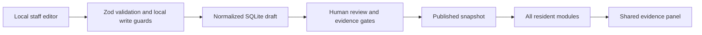

# Architecture

The Next.js App Router serves public pages from published snapshots and the local Studio from normalized draft records. Client components handle filters, comparisons, dialogs, mapping, and editing. Prisma owns server-side SQLite access; it is never imported into a browser component. Zod validates all mutations.

## Data flow

A save replaces the project's related draft records in one transaction, keeping stable record IDs. Foreign keys and schema validation enforce relationships. A monotonically increasing revision rejects stale saves and transitions. Edits invalidate affected review states on the server. Staff save the content before separately verifying it.

Publication requires Draft → Needs Review → Verified → Published. The gate validates reviewed source links, claim states, and supported related records. It does not prove factual truth. A transaction updates the public snapshot and local review history together. A snapshot is frozen between publications; later draft edits cannot leak into resident reads. Historical published snapshots are not archived as a complete versioned audit store.

## Runtime decisions

- Prisma 6.19 with SQLite avoids a separate service and uses a conventional generated client. Migrations and fixtures are tracked; the database is not.
- Next.js's documented webpack mode avoids an environment-specific Turbopack subprocess port failure. The test server has an isolated build directory.
- Maps load ArcGIS Map Components on the client. Recorded geometry renders without tiles. OpenStreetMap raster tiles are opt-in and attributed. WebGL or tile failure has a text alternative.
- Turf calculates polygon containment and distance to lines/polygon rings in metres. The 500 m proximity threshold is an explicit prototype convention, not a municipal impact definition.
- `diffWords` computes changes. Reviewers supply classifications and documented reasons; the algorithm does not infer intent.
- Participation status derives from confirmed timestamps at render time, independently of procedural stages. It never borrows a meeting timestamp as a deadline.
- No runtime AI, remote ingestion, analytics, account system, or automatic submissions are included.

## Security boundary

The supplied scripts bind to 127.0.0.1. Studio enablement, loopback Host and same-origin checks reduce accidental mutation exposure but cannot replace authentication. Disabling Studio hides its pages and blocks writes. A production design needs authenticated reads/writes, authorization, abuse controls, secure deployment, and a proper audit/backup system.

Framework references: [Next.js installation](https://nextjs.org/docs/app/getting-started/installation), [Next.js CLI](https://nextjs.org/docs/app/api-reference/cli/next), and [Prisma SQLite](https://www.prisma.io/docs/orm/v6/overview/databases/sqlite). The installed Next.js documentation is also available under `node_modules/next/dist/docs/`.

Language is client presentation state, independent of routing and stored record values. Official quotations are protected from translation. The map runtime is loaded only in the browser from the Esri CDN; npm SDK imports in its adapter are type-only. Public address search uses a licensed Region FeatureLayer rather than an unauthenticated paid locator.

## Navigation

The approved horizontal navigation is integrated into the existing `Shell` and
`ProjectFrame`; the isolated navigation preview has been removed. The global
navigation links to `/`, `/explore`, the existing municipality/category filters,
and the guide and source limitations sections on `/about`. Language changes reuse
the existing provider without changing the URL or project. Admin Portal remains
an independent `/admin` entry, and Municipal Studio remains available through the
footer and the Admin Portal.

Project navigation appears only inside a selected project's frame. Real links
connect the overview, Decision DNA, Impact Explorer, Public Voice and Action
Navigator. Documents link to the existing source library, which also links to
recorded version comparisons. Sources retain their original titles and evidence
links. Breadcrumbs lead back to the project and the live project list. Browser
history, refresh and direct project URLs use the existing App Router routes.

Dropdowns support click, Tab, arrow keys, Escape, outside click and focus dismissal.
The global navigation folds below 1200px and project navigation below 700px. At
390px, each menu expands vertically rather than crowding the project tabs. Shared
styles live in `globals.css`; translated navigation labels live in the existing
French and Simplified Chinese dictionaries. No static demo records, new database
schema, authentication, publishing behavior or deployment settings are added.

Public discovery lists and municipality filters exclude synthetic records. The
fictional-case switch has been removed; stored fixtures remain available to
internal regression tests without deleting development records. Repeated sitewide
notices and promotional captions are removed from the browsing interface. The
About page retains platform limitations, source handling and privacy information;
project evidence, unknown states, map attribution and error messages remain.
